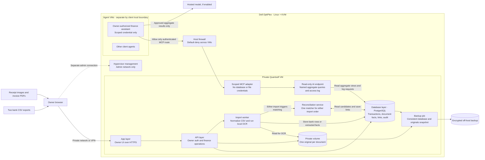

# Proposed Quantself budgeting architecture

- **Deployment.** Keep the web app, API, worker, PostgreSQL and private document volume in one Quantself VM. Containers inside it simplify deployment and resource limits. The VM boundary separates Quantself from agent workloads. Agent networks have no route to the owner API, database, document storage, backup storage or hypervisor management. The authorized assistant gets only the MCP route. Same-host isolation still depends on the hypervisor and host administration. [Docker isolation](https://docs.docker.com/engine/security/) · [NIST hypervisor guidance](https://csrc.nist.gov/pubs/sp/800/125/a/r1/final)
- **AI access.** Expose fixed aggregate queries such as monthly spending by category. Use a separate scope from `budgeting:read`, which currently permits receipt detail and original access. Enforce the credential, fixed reporting periods and minimum bucket sizes server-side. Exclude raw text, notes, identifiers, exact transaction rows, images and file links. Audit the caller, query, period, time and outcome. Allow only the assistant you authorize.
- **Tax evidence.** Store original images and PDFs with source metadata and a content hash. The Owner can open or export the original and its linked payment. Keep encrypted off-host backups of both records and originals, and test restoration. Extraction serves search and matching. Original records preserve the evidence. [CRA electronic imaging guidance](https://www.canada.ca/en/revenue-agency/services/tax/businesses/topics/keeping-records/acceptable-format-imaging-paper-documents-backing-electronic-files.html)
- **Imports and OCR.** Use typed fields for the values used in matching and reporting. The original covers vendor-specific detail. Run OCR in a bounded queue and accept clear matches automatically. Surface unmatched items and failed extractions without making them a required workflow. OCR confidence alone cannot establish a payment.
- **Consistent matching.** Upsert normalized source records first and run the same reconciler after either import. Compare currency, amount, merchant and date across the full affected candidate set. Link a pair only when it is uniquely strong on both sides. Recompute derived links when later imports add competing candidates. Count posted transactions once in bank totals. Each transaction can point to one document, and several payments can point to the same invoice. Archive extra documents independently. Deleting evidence unlinks it while preserving imported bank entries. The current receipt-to-expense cascade needs to change for bank-linked records. A separately confirmed cash expense may enter the budget as its own transaction.
